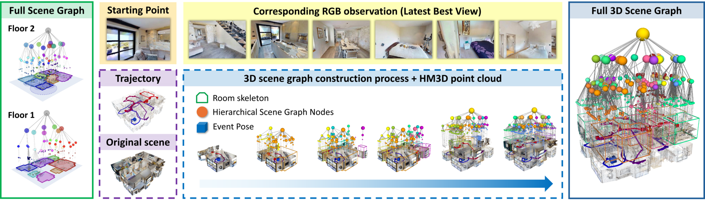

# INHerit-SG

[](https://arxiv.org/abs/2602.12971)
[](https://fangyuktung.github.io/INHeritSG.github.io/)
[](LICENSE)
[](https://fangyuktung.github.io/INHeritSG.github.io/#teaser-video)

> **INHerit-SG: Incremental Hierarchical Semantic Scene Graphs for Complex Embodied Retrieval**
>
> YukTungSamuel Fang, Zhikang Shi, Jiabin Qiu, Zixuan Chen, Jieqi Shi, Hao Xu, Jing Huo, and Yang Gao.
>
> arXiv:2602.12971, 2026.

<p align="center">
  
</p>

INHerit-SG turns posed RGB-D observations into a floor–room–area–object scene graph. At query time, it combines typed constraints, evidence routing, three retrieval paths, and selective visual reranking to find objects described by complex instructions.

This repository provides the INHerit-SG mapping and retrieval pipeline, HM3DSem-SQR annotations and evaluator, and baseline and ViGiL3D adapters.

## Get started

### Install

Use Python 3.10 or newer in a fresh environment. From this repository:

```sh
python -m pip install -e .
inherit-sg --help
```

Retrieval uses `sentence-transformers/all-MiniLM-L6-v2`. Set `INHERIT_SG_TEXT_ENCODER` to a local copy for offline use. Mapping requires compatible PyTorch/torchvision, SAM 3 and DINOv3. Run `pip install -e '.[mapping]'`, then follow [mapping setup](docs/MAPPING.md) to configure their checkpoints.

### Build a map

Mapping needs the additional models and environment described in [mapping setup](docs/MAPPING.md), plus a posed RGB-D trajectory. Copy `configs/default.yaml`, set its output directory and camera settings, then run:

```sh
export INHERIT_TRAJECTORY=/absolute/path/to/episode
inherit-sg map --config configs/default.yaml
```

### Query a map

Copy `configs/retrieval.yaml`, select models available on your OpenAI-compatible service or local server, and set `INHERIT_API_BASE` and `INHERIT_API_KEY` in your environment.

```sh
inherit-sg query --config configs/retrieval.yaml \
  --map outputs/example-map --text 'Find a red cup that is not plastic.'
```

The result contains the predicted object, candidate IDs and 3D positions, evidence route, and reranking trace. Use `--no-visual` for text-only retrieval. Supply `--constraints query.json --no-visual` to bypass model parsing and visual reranking; the constraints schema is documented in [method and parameters](docs/METHOD.md).

The same map can be exported for a language model to read directly:

```sh
inherit-sg export-memory --map outputs/example-map --output memory.json
```

## Dataset and evaluation

The repository includes 6,084 generated queries across 36 scenes, 864 reviewed queries, scene metadata, and the Main-864 / Core-432 / Map-96 splits. It also provides camera poses for 39,598 selected frames. Use the reviewed annotations and [evaluation instructions](docs/DATA.md) for benchmark results.

Obtain the HM3D v0.2 validation meshes, semantic annotations, and semantic configs from [Matterport's official download page](https://github.com/matterport/habitat-matterport-3dresearch#-downloading-hm3d-v02) under its [dataset terms](https://matterport.com/legal/matterport-end-user-license-agreement-academic-use-model-data). Place them under one asset root, then render the provided poses locally:

```sh
python scripts/render_hm3dsqr.py --verify-only
python scripts/render_hm3dsqr.py --assets /path/to/hm3d-v0.2 \
  --output data/trajectories
```

Use `data/trajectories/val/<scene>/ep_000` for mapping and `data/reviewed/` for evaluation. See [rendering requirements](docs/DATA.md#reconstruct-the-mapping-inputs) for the asset layout.

```sh
python evaluation/run_retrieval.py --maps-root outputs/maps \
  --output outputs/predictions/inherit_sg
python evaluation/aggregate_retrieval.py outputs/predictions \
  --output outputs/evaluation/main864
```

`outputs/maps` contains `<scene_id>/ep_000/` maps. The evaluator requires one prediction per query.

## Adapters

[Adapter documentation](docs/ADAPTERS.md) covers the paper baselines and ViGiL3D Mask3D / GT-box protocols. Install each baseline's software and checkpoints from its upstream release.

## License

INHerit-SG code is MIT licensed. HM3D-derived poses, queries, and scene annotations are for academic, non-commercial use under the [Matterport agreement](https://matterport.com/legal/matterport-end-user-license-agreement-academic-use-model-data). Third-party notices are listed in [THIRD_PARTY.md](THIRD_PARTY.md).
